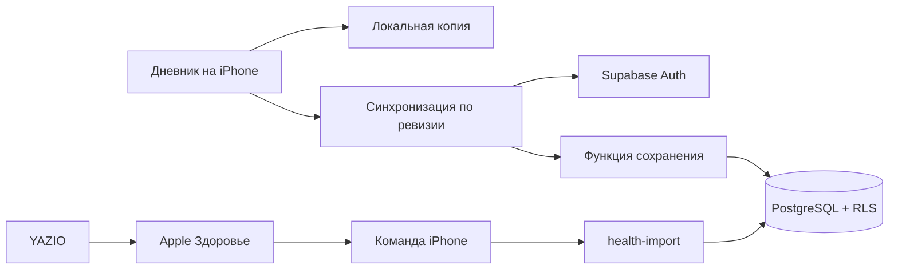

# Архитектура WEDX

WEDX — личное приложение тренировок с локальной записью и облачной синхронизацией. Интерфейс остаётся веб-приложением, которое можно добавить на главный экран iPhone. База, авторизация, интеграции и развёртывание отделены от интерфейса. Нативное iOS-приложение пока не создано.

## Границы кода

- `src/app.js`: существующий редактор тренировок, таймер и экраны прогресса. Это сохранённая часть прежнего интерфейса; его дальнейшее разбиение можно делать по мере изменений.
- `src/domain`: программа тренировок, проверка формата состояния.
- `src/data/local-store.js`: совместимость со старым localStorage и резервная копия перед миграцией.
- `src/data/sync-engine.js`: независимая от интерфейса синхронизация, повторная отправка, конфликты и смена аккаунта.
- `src/data/supabase.js`, `cloud.js`: клиент Supabase, сохранённая сессия, подключение устройства личной ссылкой и перенос прежних копий.
- `scripts/generate-device-link.mjs`: административный выпуск одноразовой ссылки без отправки email; не входит в веб-сборку.
- `src/features/integrations`: список подключений, выпуск и отзыв ключей, отображение питания.
- `supabase/migrations`: схема PostgreSQL, RLS, функции атомарной записи и импорта.
- `supabase/functions/health-import`: внешний API приёма питания, проверка формата и интеграционного ключа.

## Данные и совместимость

`workout_state` содержит полный документ редактора и монотонную серверную ревизию. В одной транзакции `save_workout_state` сохраняет документ, резерв предыдущей версии и обновляет структурированные таблицы `gyms`, `workout_sessions`, `exercise_history`, `exercise_sets`, `body_measurements`. Эти таблицы пока являются проекциями документа: менять их напрямую нельзя. Это сознательный промежуточный шаг, который сохраняет все возможности старого редактора и даёт нормальные SQL-запросы для будущей аналитики.

Питание хранится независимо в `nutrition_daily`. Оно не перезаписывается сохранением тренировки. Ключ дневной записи — пользователь + источник + календарная дата. Время тренировки в прежнем редакторе до 03:00 относится к предыдущему дню; питание использует календарный день iPhone. Эти две семантики не смешиваются.

RLS разрешает чтение только строк владельца. Запись тренировок идёт через RPC с проверкой `auth.uid()`, ожидаемой ревизии и владельца запроса. Конфликт требует выбора пользователя. До ответа сервера изменения уже записаны локально; при следующем открытии или восстановлении сети отправка повторяется. Фоновая отправка в закрытом Safari не гарантируется.

## Подключения

Первая реализованная точка входа — дневные калории/белок YAZIO, переданные из Apple Health через отдельно настроенную команду. Это API импорта, а не прямой вход в аккаунт YAZIO. Токен создаётся на устройстве, его SHA-256 хранится в базе. Он даёт право только на импорт питания и может быть отозван. Ключ `service_role` используется только внутри Edge Function.

`integration_runs` обеспечивает идемпотентность запроса за 90 дней; сама дневная таблица всегда обновляется по ключу, поэтому повторная отправка не складывает два одинаковых итога. Лимиты: 31 день и 64 КБ на запрос, 30 новых импортов в минуту на пользователя. Логи не содержат исходные токены.

Для нового сервиса: подтвердить доступный официальный способ получения данных, добавить адаптер/endpoint, определить таблицу и уникальный ключ источника, добавить RLS и тесты повторного импорта. OAuth-секреты и обмен кодов должны оставаться на стороне Edge Function. Не добавлять фиктивную кнопку «подключено» без работающего канала данных.

Invictus пока указан как недоступный: экспорт времени входа/выхода не подтверждён. Apple Health напрямую в браузере недоступен. Позже можно добавить оболочку iOS с HealthKit, которая будет пользоваться теми же таблицами и контрактами API, сохранив веб-версию.

## Эксплуатационные ограничения

- Рабочий проект Supabase подключён; параметры клиента задаются через окружение, схема версионируется миграциями.
- На Free проект может приостанавливаться, а браузер может удалить локальное хранилище. Нужны периодические выгрузки копий.
- Устройство хранит сессию и локальную историю. В интерфейсе нет формы входа, регистрации и выхода. После удаления хранилища нужна новая личная ссылка. При подключении другой учётной записи история переключается на её локальную копию и не отправляется чужому аккаунту.
- Сброс пароля и административное удаление аккаунта пока выполняются через Supabase; отдельные экраны не реализованы.
- Серверная синхронизация и импорт проверены на рабочем проекте; разрешения Apple Health и автоматизацию нужно настроить непосредственно на iPhone.
